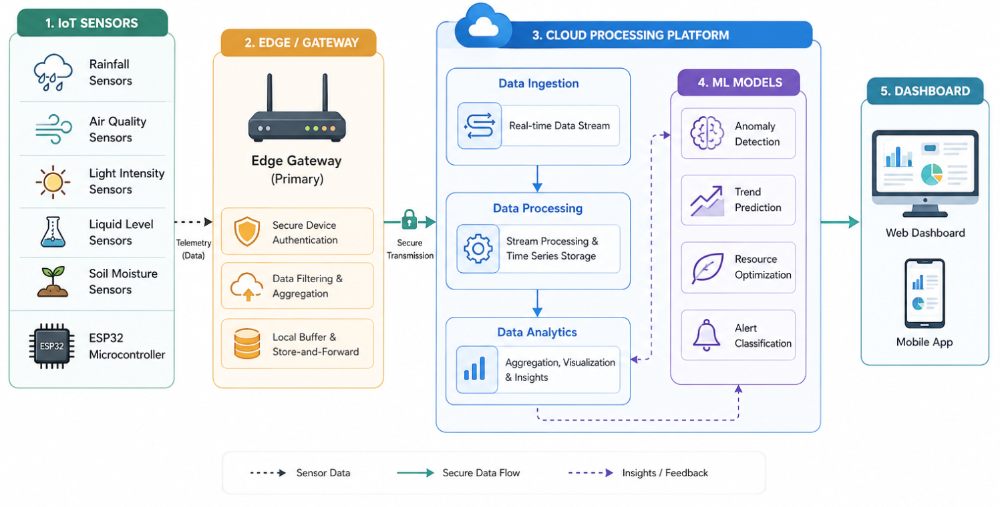
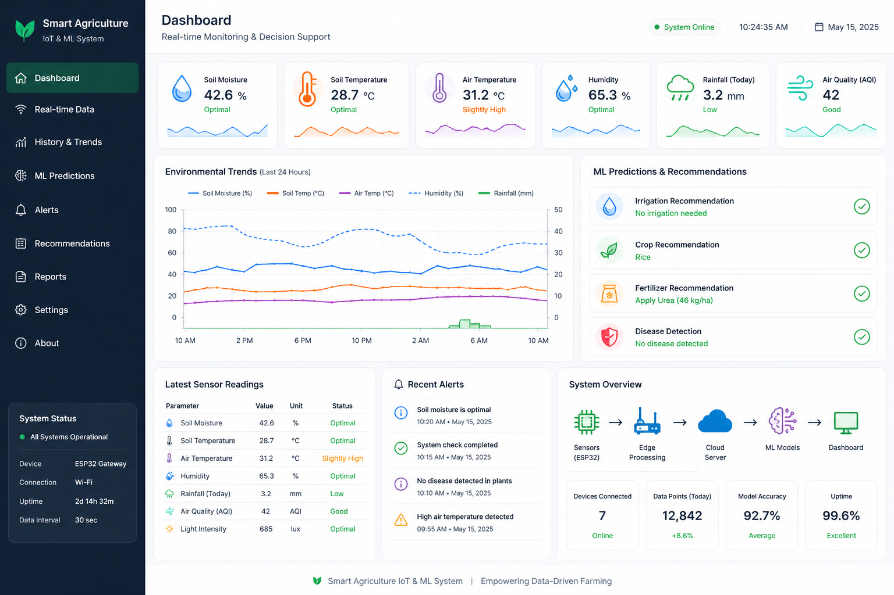
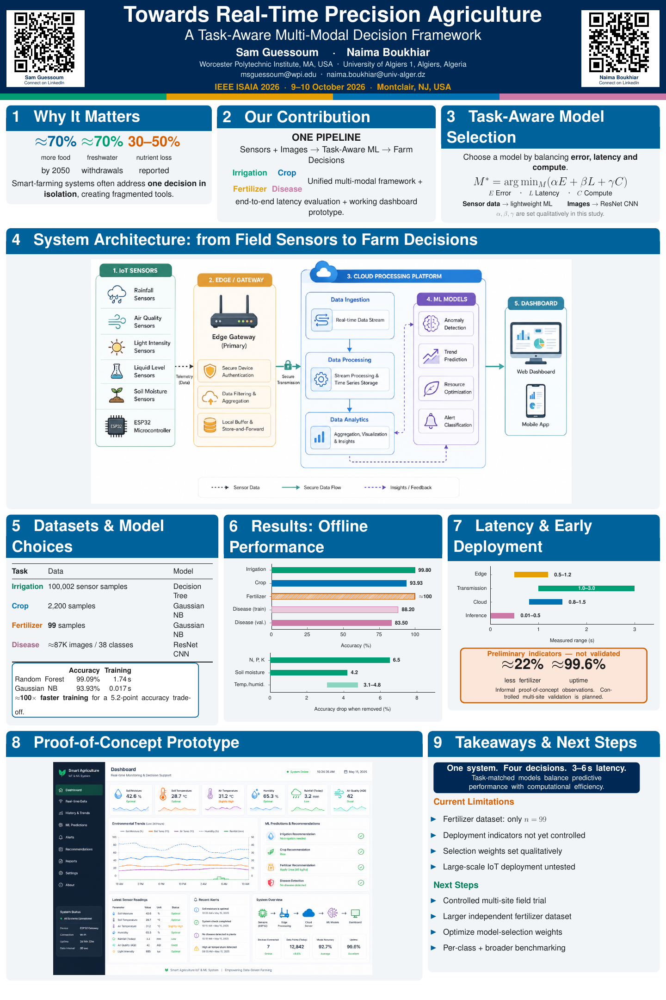

# Towards Real-Time Precision Agriculture: A Task-Aware Multi-Modal Decision Framework

[](https://www.ieeeisaia.com/)
[](paper/Towards_RealTime_Precision_Agriculture_ISAIA2026.pdf)
[](certificates/IEEE_ISAIA_2026_Travel_Grant_Award.pdf)

**Sam Guessoum**¹ · **Naima Boukhiar**²
¹ Worcester Polytechnic Institute, Worcester, MA, USA · ² University of Algiers 1, Algiers, Algeria

Presented at the **2026 IEEE International Conference on Intelligent Systems and
Interdisciplinary Applications (IEEE ISAIA 2026)**, October 9–10, 2026, Montclair, New Jersey, USA.
Interactive session, Poster #006, Track 6, presented onsite.

| 📄 [Paper](paper/Towards_RealTime_Precision_Agriculture_ISAIA2026.pdf) | 🖼️ [Poster](poster/ISAIA2026_Poster.pdf) | 🏅 [Participation certificate](certificates/Participation_Certificate_IEEE_ISAIA_2026.pdf) | ✈️ [Travel Grant Award](certificates/IEEE_ISAIA_2026_Travel_Grant_Award.pdf) | 🗓️ [Program](conference/interactive_session_program.png) |
|---|---|---|---|---|

---

## Abstract

Precision agriculture requires real-time, data-driven decision-making to optimize resource use
under environmental constraints. However, existing solutions often address tasks such as
irrigation, crop recommendation and disease detection independently, leading to fragmented
systems.

This paper presents a task-aware multi-modal framework that integrates IoT sensing, cloud
processing and adaptive machine learning into a unified decision-support pipeline. The system
processes both structured sensor data and image data, and selects models dynamically based on
modality, latency and computational cost.

Experimental results show strong performance: 99.80% accuracy for irrigation prediction,
93.93% for crop recommendation and 83.50% for disease detection, with end-to-end latency
between 3 and 6 seconds. A preliminary proof-of-concept deployment indicated an approximate
22% reduction in fertilizer usage and approximately 99.6% system uptime. These figures are
early, informally observed indicators rather than outcomes of a controlled, systematically
documented field trial.

## Contributions

- **One unified pipeline for four tasks** (irrigation, crop recommendation, fertilizer
  recommendation, plant disease detection), integrating IoT sensing, edge preprocessing,
  cloud analytics and ML inference.
- **Task-aware model selection.** Each task's model is chosen by trading off prediction error
  *E*, inference latency *L* and computational cost *C*:

  $$M^{*} = \arg\min_{M} \big(\alpha E(M) + \beta L(M) + \gamma C(M)\big)$$

  Lightweight models serve structured sensor data. A deep CNN handles images. α, β and γ were
  set qualitatively in this study.
- **End-to-end evaluation**: offline accuracy on four datasets, feature ablation, and a
  per-stage latency budget.
- **A working dashboard prototype** that shows live sensor readings next to model
  recommendations.

## System architecture

<p align="center">
  
  <br><em>Fig. 1. From field sensors (ESP32) through the edge gateway (authentication, filtering, store-and-forward buffering) to cloud ingestion, ML inference and the web/mobile dashboard.</em>
</p>

| Layer | Components | Function |
|---|---|---|
| Sensing | IoT sensors, ESP32 | Data acquisition |
| Edge processing | Gateway, filtering, buffering | Preprocessing and validation |
| Cloud processing | Data ingestion, storage, ML models | Analytics and inference |
| Application | Dashboard, mobile app | Visualization and decision support |

Structured input vector: **x** = [N, P, K, M, T<sub>s</sub>, H<sub>s</sub>, pH, R, T<sub>a</sub>, H<sub>a</sub>]
(soil macronutrients, soil moisture, soil temperature and humidity, pH, rainfall, air
temperature and humidity). Disease detection takes a leaf image *I* ∈ ℝ<sup>H×W×C</sup>.

## Datasets and models

| Task | Data | Split | Model | Why this model |
|---|---|---|---|---|
| Irrigation | 100,002 sensor samples (public smart-irrigation data) | 80 / 10 / 10 | Decision Tree | Threshold-based splits on environmental variables |
| Crop recommendation | 2,200 samples (Kaggle) | 70 / 15 / 15 | Gaussian Naive Bayes | ~100× faster training than Random Forest |
| Fertilizer recommendation | 99 samples (Kaggle) | 5-fold CV | Gaussian Naive Bayes | Efficiency |
| Disease detection | ~87,000 images, 38 classes (PlantVillage) | 70 / 15 / 15 | ResNet CNN | Hierarchical visual features |

The latency-weighted choice for crop recommendation:

| Model | Accuracy | Training time |
|---|---|---|
| Random Forest | 99.09% | 1.74 s |
| **Gaussian Naive Bayes** (selected) | 93.93% | **0.017 s** |

## Results

### Predictive performance

| Task | Accuracy | F1 | Size | Model |
|---|---|---|---|---|
| Irrigation | **99.80%** | 0.998 | 100K | Decision Tree |
| Crop type | **93.93%** | 0.938 | 2,200 | GNB |
| Fertilizer | ≈100% | ≈1.00 | 99 | GNB |
| Disease | **83.50%** (validation) | 0.835 | 87K | ResNet |

For irrigation, precision is 0.9981 and recall 0.9980. The disease model reaches ≈88.2%
training vs. 83.5% validation accuracy, a moderate generalization gap. The fertilizer result
comes from only 99 samples and should be treated as advisory.

### Feature ablation (accuracy drop when a feature is removed)

| Feature(s) | Task | Δ accuracy |
|---|---|---|
| N, P, K | crop and fertilizer | ≈ 6.5% |
| Soil moisture | irrigation | ≈ 4.2% |
| Temperature, humidity | all tasks | 3.1 – 4.8% |

### End-to-end latency

L<sub>total</sub> = L<sub>edge</sub> + L<sub>transmission</sub> + L<sub>cloud</sub> + L<sub>inference</sub>

| Stage | Measured range |
|---|---|
| Edge processing | 0.5 – 1.2 s |
| Transmission | 1.0 – 3.0 s |
| Cloud processing | 0.8 – 1.5 s |
| Inference | 0.01 s (lightweight) – ≈0.5 s (ResNet) |
| **Total** | **3 – 6 s** |

### Proof-of-concept prototype

<p align="center">
  
  <br><em>Fig. 2. Web dashboard: live readings, trend charts, and irrigation, crop, fertilizer and disease recommendations.</em>
</p>

## Limitations and next steps

The paper states these openly, and they are part of the contribution:

- The **≈22% fertilizer reduction and ≈99.6% uptime** come from an informal preliminary
  deployment. Site details, duration and a controlled baseline weren't logged. A **controlled
  multi-site longitudinal field trial** is planned.
- The **fertilizer dataset has only 99 samples**. It needs a larger, independent dataset.
- **α, β, γ were set qualitatively.** Formalizing the selection weights is future work.
- Per-class precision/recall, broader model benchmarking, scalability with many concurrent
  devices, and encrypted transport are still open.

## Poster

<p align="center">
  <a href="poster/ISAIA2026_Poster.pdf"></a>
</p>

## Recognition

<p align="center">
  <a href="certificates/Participation_Certificate_IEEE_ISAIA_2026.pdf"></a>
  <a href="certificates/IEEE_ISAIA_2026_Travel_Grant_Award.pdf"></a>
</p>

- **IEEE Travel Grant Award**, IEEE Region 1 & North Jersey Section, to support participation in ISAIA 2026.
- **Certificate of Participation**, IEEE ISAIA 2026.
- Listed in the [interactive session program](conference/interactive_session_program.png) (Day 1, October 9, 2026, poster #006).
- [Acceptance notification](conference/acceptance_notification.png): accepted for presentation and inclusion in the conference proceedings.

## Repository contents

```
Towards_RealTime_Precision_Agriculture/
├── paper/          Towards_RealTime_Precision_Agriculture_ISAIA2026.pdf
├── poster/         ISAIA2026_Poster.pdf, poster_preview.png
├── figures/        fig1_system_architecture.png, fig2_dashboard_prototype.png
├── certificates/   participation certificate and Travel Grant Award (PDF + previews)
└── conference/     interactive session program, acceptance notification
```

## Related repositories

- [hurudza-iot-telemetry](https://github.com/naimabouk/hurudza-iot-telemetry): ESP32 multi-sensor field node (RS-485 NPK probe, environmental sensors, cloud telemetry)
- [upmo-smart-agriculture](https://github.com/naimabouk/upmo-smart-agriculture): uncertainty-aware multi-objective optimization for smart agriculture (ACIT'2026)

## Citation

```bibtex
@inproceedings{guessoum2026realtime,
  title     = {Towards Real-Time Precision Agriculture: A Task-Aware Multi-Modal Decision Framework},
  author    = {Guessoum, Sam and Boukhiar, Naima},
  booktitle = {Proceedings of the 2026 IEEE International Conference on Intelligent Systems
               and Interdisciplinary Applications (ISAIA)},
  address   = {Montclair, NJ, USA},
  year      = {2026},
  note      = {Paper ID 102. To appear in IEEE Xplore}
}
```

## Contact

**Naima Boukhiar**, University of Algiers 1 · naima.boukhiar@univ-alger.dz
**Sam Guessoum**, Worcester Polytechnic Institute · msguessoum@wpi.edu

---

<sub>© 2026 IEEE. Personal use of this material is permitted. Permission from IEEE must be
obtained for all other uses, in any current or future media, including reprinting/republishing
this material for advertising or promotional purposes, creating new collective works, for
resale or redistribution to servers or lists, or reuse of any copyrighted component of this
work in other works. The PDF in this repository is the authors' accepted manuscript.</sub>
